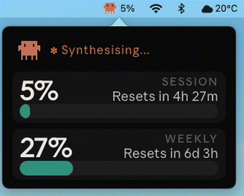
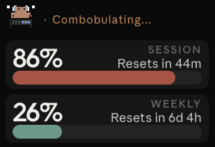

# Clawdbar

Claude usage in your macOS menu bar, read from **Anthropic's official rate-limit headers**.





## What it does

Clawdbar reads your live Claude quota from the same rate-limit headers that Claude Code monitors — no token counting, no local log parsing. A daemon on your Mac probes the API every 60 seconds; a menu bar app shows the current session % beside a pixel Clawd icon. Click to open a popover with the full usage animation, session (5h) and weekly (7d) bars, and reset countdowns.

## Requirements

- **macOS** (Apple Silicon or Intel)
- **Claude Code** logged in on this Mac (`claude login`)
- **uv** (`brew install uv`)

## Install

```bash
bash install.sh
```

One command. Builds a venv at `~/.clawdbar/.venv`, generates the menu bar icon, stages the project, and loads two LaunchAgents. The Clawd icon appears within a few seconds.

## Tuning

Set these in the daemon plist's `EnvironmentVariables`, then re-run `install.sh`:

| Env var | Default | Meaning |
|---|---|---|
| `CLAWDBAR_POLL` | `60` | Seconds between API polls |
| `CLAWDBAR_CREDENTIALS` | `~/.claude/.credentials.json` | Credentials file (Keychain tried first) |

## Daily use

- **Menu bar:** pixel Clawd icon + current session %.
- **Click:** popover with the live animation, session (5h) and weekly (7d) bars, reset countdowns, and "official quota" labels. Tap the animation to cycle through all 13 presets.

## Commands

```bash
launchctl list | grep clawdbar                               # both agents should appear
curl -s http://127.0.0.1:7337/usage | python3 -m json.tool  # check the daemon
tail -F ~/Library/Logs/clawdbar.out.log                      # daemon logs
tail -F ~/Library/Logs/clawdbar-menubar.err.log              # menu bar logs
uv run --with pytest pytest -q                               # tests
bash install.sh                                              # restart after edits
```

## Uninstall

```bash
launchctl unload ~/Library/LaunchAgents/io.clawdbar.plist
launchctl unload ~/Library/LaunchAgents/io.clawdbar.menubar.plist
rm -rf ~/.clawdbar \
  ~/Library/LaunchAgents/io.clawdbar.plist \
  ~/Library/LaunchAgents/io.clawdbar.menubar.plist
```

## Attribution

- Inspired by [HermannBjorgvin/Clawdmeter](https://github.com/HermannBjorgvin/Clawdmeter) — same rate-limit header approach, clean rewrite.
- Pixel-art Clawd animations by [@amaanbuilds](https://github.com/amaanbuilds), sourced from [claudepix.vercel.app](https://claudepix.vercel.app/). Frame data and palettes scraped and converted by the tooling in `tools/`.
- The Clawd character is Anthropic's mascot. This project is not affiliated with or endorsed by Anthropic.

## Legal

This project sits in a licensing grey area and is intentionally not released under an open-source license.

The source code is original work. However, `static/index.html` embeds pixel-art Clawd sprites from claudepix (@amaanbuilds), the Clawd mascot is Anthropic's copyrighted character, and the Anthropic Sans/Serif fonts that the popover loads (if present on your system) are proprietary typefaces Anthropic holds a license for — none of which this project has explicit permission to use or redistribute.

Because of these bundled third-party assets, applying a permissive or copyleft license to the repository as a whole would be misleading. You are free to read and adapt the code for personal use, but be aware that the visual assets carry third-party copyright. Obtain appropriate permissions before any commercial or large-scale redistribution.

**You have been warned.**
